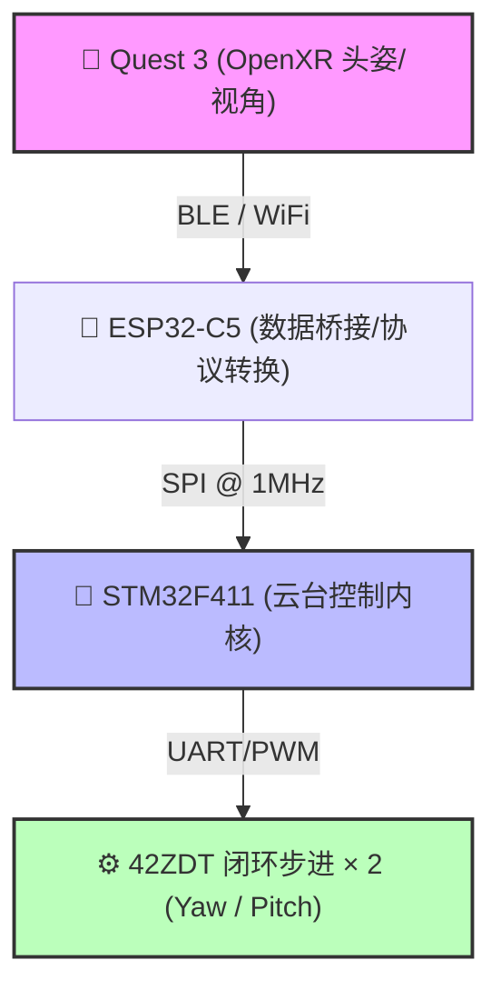

对的对的，大肥鱼协力制作，会改的更像人话的（吧


及其猫言：
<file-card title="README_ULTIMATE.md" type="text/markdown">
# 🚀 HT TURRET (Apache Simulation Edition)

## 🛰️ 项目简介
`HT TURRET` 是一款专门为追求极致沉浸感的玩家设计的 **阿帕奇 (Apache) 武器系统模拟器**。它通过将虚拟现实（VR）的头动数据转化为物理空间的机械动作，实现了一套完整的“头瞄”打击逻辑。

简单来说：通过你的 Quest 3 视角，直接接管两轴步进云台。你的头往哪转，云台就往哪锁；你在头显里看到的不仅仅是图传画面，那是战场的实时视野。你现在不是在操控一个机器，你是在**cos 阿帕奇武器官**——眼神所向，即是打击目标！

## 📐 系统架构 (The Kill Chain)

为了实现这种“意念控制”的打击精度，我们构建了一套从高层指令到物理执行的硬核链路：



## 🛠️ 核心黑科技 (Features)

- **🎯 沉浸式“头瞄”锁定**：利用 Quest 3 的 OpenXR 姿态数据，通过高频通讯链路，实现视角与云台的毫秒级同步，实现真正的“所见即所得”。
- **📡 战术数据链路**：
    - **多模态传输**：支持 BLE/WiFi 双模式，在低延迟与高可靠性之间自由切换，随心所欲。
    - **跨代际接力**：从 Quest 3 到底层的 STM32，由 ESP32-C5 完成“信号转译”，这延迟低得让对手怀疑人生。
- **🕹️ 工业级闭环控制**：驱动 42ZDT 闭环步进电机，Yaw/Pitch 两轴精准掌控，拒绝机械抖动，只求锁定目标。
- **🖥️ 全息火控面板**：头显内集成实时图传、云台姿态及系统参数，将整套火控系统 (FCS) 完美复刻在你的视野之中。

## 📦 仓库资产 (Assets)
- **`firmware/`**：核心固件库（STM32F411 实时控制 + ESP32-C5 协议桥接）。
- **`apps/`**：Quest 原生 App (Unity 6.3) & WebXR 网页版，适配多种交互场景。
- **`docs/`**：从硬件接线到系统点亮的全流程技术文档。

---
*⚠️ 警告：火力太猛，cos 过程中请确保目标不在你的生活范围内。*
</file-card>


# HT TURRET
**两轴步进云台 + Quest 3 头瞄**系统。

头显里的视角传给云台，云台跟着你的头转；同时头显面板上能看到图传画面、云台状态和参数。

```
        Quest 3（OpenXR 头姿）
          │
   BLE / WiFi（二选一）
          ↓
     ESP32-C5（桥接）
          │ SPI 1 MHz
          ↓
     STM32F411（云台控制）
          │ UART
          ↓
   42ZDT 闭环步进 × 2（yaw / pitch）
```

---

## 仓库结构

```
firmware/
├── f411/        STM32F411 云台固件（CMake + arm-none-eabi）
└── c5/          ESP32-C5 桥接固件（ESP-IDF v5.5）

apps/
├── quest-unity/ Quest 3 原生 App（Unity 6.3 + OpenXR，BLE）
└── quest-web/   Quest Browser 网页版（WebXR + WiFi）

tools/           调参 / 抓日志 / 构建辅助脚本

docs/
├── wiring.md        接线与供电
├── protocol.md      空口帧、SPI 帧、遥测格式
├── bringup.md       从零点亮的分步流程
└── known-issues.md  踩过的坑与系统限制

release/         已编译产物（固件入库；APK 走 GitHub Releases）
├── f411/        stm32test.elf / .hex / .bin
├── c5/          app.bin / bootloader.bin / partition-table.bin
└── app/         HTSender.apk
```

---

## 快速开始

### 1. 烧 F411

```bash
# ST-Link（只接 SWDIO / SWCLK / GND，不要接 3V3）
STM32_Programmer_CLI -c port=SWD -w release/f411/stm32test.elf -rst
```

上电后云台会自动跑一遍限位校准：pitch 缓慢顶到机械挡块 → 回退 → 停到 18° 正角。

### 2. 烧 C5

```bash
# 先选模式：firmware/c5/main/ht_mode.h
#   #define HT_MODE 1   → WiFi（配合网页版）
#   #define HT_MODE 2   → BLE（配合 App）

idf.py set-target esp32c5
idf.py build
esptool.py --chip esp32c5 -p COMx -b 460800 write_flash \
  0x2000  build/bootloader/bootloader.bin \
  0x8000  build/partition_table/partition-table.bin \
  0x10000 build/esp32c5_test.bin
```

### 3. 装 App

```bash
adb install -r release/app/HTSender.apk
```

### 4. 跑网页版（可选）

```bash
cd web
python devserver.py 8080
```

---

## App 用法

- 面板浮在视野前方，**准星**跟随手柄（骗你的，准星根本没搞出来）
- 指到按钮变绿，**扣扳机**触发
- `SETUP` 进参数页；`VIDEO SOURCE...` 选图传源

参数可以在设备上改，不用重新打包：

```
/sdcard/Android/data/com.ht.turret/files/ht.cfg
```

```properties
down=1.25      # 面板比眼睛低多少米
dist=2.35      # 面板距离
width=4.80     # 面板宽度
followk=0.10   # 跟随比例（1=贴死视野）
pass=1         # 透视
vsrc=2         # 图传源：0关 1USB 2有线 3无线
```

日志同样在设备上：

```
/sdcard/Android/data/com.ht.turret/files/app.log
```

---

## 图传

| 方案 | 状态 | 说明 |
|---|---|---|
| 采集卡直插 Quest 3 | ❌ | 系统只把 USB 视频当“外部显示器”，第三方读不到（附日志证据见 `docs/known-issues.md`） |
| **PC 中转 MJPEG** | ✅ | `采集卡 → devserver → adb reverse/WiFi → App`，720p 约 33~45 fps |
| H.264 硬解 | ⏳ | 想上 1080p120 需要接 MediaCodec |

---

## 构建环境

| 部分 | 版本 |
|---|---|
| STM32 | CMake 3.30 + ninja + arm-none-eabi-gcc 14.3 |
| ESP32 | ESP-IDF v5.5.6 |
| Unity | 6000.3.29f1（Unity 6.3 LTS）+ OpenXR 1.19 + Meta OpenXR 2.7 + AR Foundation 6.7 |
| Android | minSdk 32 / targetSdk 34 / ARM64 |

---

## 状态

| 模块 | 状态 |
|---|---|
| 头姿 → BLE → C5 → F411 | ✅ |
| 云台跟随（跨 ±180° 不绕圈） | ✅ |
| 限位自校准 + 回正 | ✅ |
| App 面板 / 准星 / 手柄点击 | ✅ |
| 透视（Passthrough） | ✅ |
| 图传（PC 中转） | ✅ |
| 1080p120 / 硬解 | ⏳ |

细节与坑位见 [`docs/known-issues.md`](docs/known-issues.md)。
---

## bridge/（Node 侧工具链）

原 HeadTracking.Bridge monorepo 里还有用的部分，一并收进仓库：

```
bridge/
├── packages/protocol/   16 B 空口帧 + 30 B F411 帧：编解码、CRC、JSON Schema、单测
├── apps/relay/          PC 中转：WebSocket → UDP → C5
├── apps/console/        桌面控制台（PowerShell / WPF）
└── tools/               mockpose.ps1（假头姿源）、ble_latency.py 等实测脚本
```

跑起来：

```bash
cd bridge
npm install
npm test              # 帧编解码单测
npm run mock:pose     # 假头姿，方便不带头显调云台
npm run ble:latency   # 量 BLE 往返延迟
```

图传中转用的是 pps/quest-web/devserver.py（Python，跨平台、零依赖），
pps/relay 是更早的 WebSocket 方案，保留作参考。

---

## 分析文档

docs/analysis/ 下是选型与实测记录，按需查：

| 文档 | 内容 |
|---|---|
| LINK_OPTIONS.md | WiFi / ESP-NOW / BLE 三条链路对比 |
| WIFI_VS_BLE.md | 实测延迟与抖动 |
| RF_5G_ANALYSIS.md | 5.8G 图传与 WiFi 干扰 |
| QUEST3_HEADTRACK.md | OpenXR 头姿获取方式 |
| PC_VIDEO_BRIDGE.md | 图传经 PC 中转的方案 |
| APK_FEASIBILITY.md | 为什么最后做成 App |
| FIRMWARE.md | 两 MCU 配置与坑位 |
| DECISIONS.md | 关键决策记录 |
